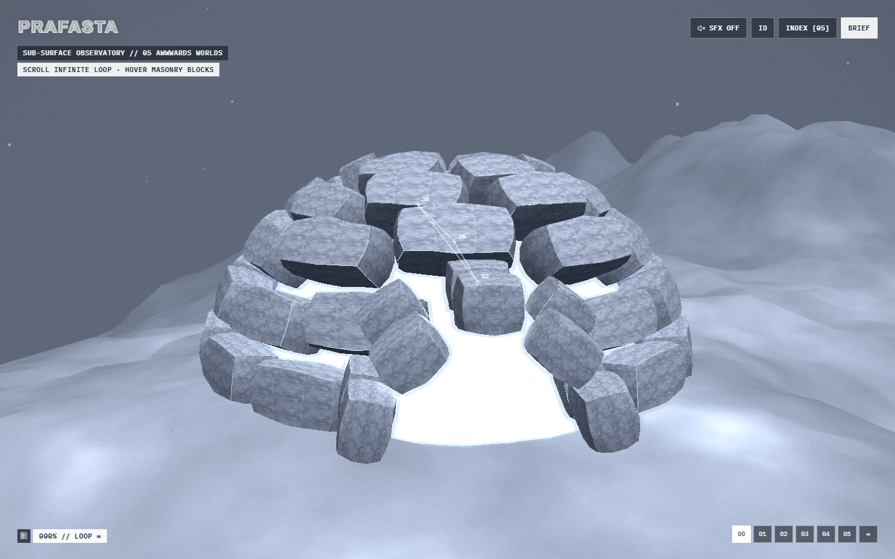

# PRAFASTA · Sub-Surface Quartz Observatory (Five-World 3D WebGL Portfolio Hub)

**Live Demo:** [https://prafasta-monograph.vercel.app](https://prafasta-monograph.vercel.app) · **Repository:** [github.com/MrEuwn/portfolio-hub](https://github.com/MrEuwn/portfolio-hub)

| Surface Observatory & 1px Block Tracking | 8-Segment Stone Stargate Ring |
| :---: | :---: |
|  |  |

| 15,000-Point Volumetric Sculpture Pedestal | Chamber Inspection & Live Simulator |
| :---: | :---: |
|  |  |

100% fullscreen zero-scrollbar 3D WebGL2 spatial portfolio hub engineered with continuous bidirectional **infinite scroll loop** mechanics:

1. **Isometric 3D Wireframe CAD Loader (`00 -> 100%`):** Draws geodesic masonry edges and 3D spatial survey coordinates over overcast mineral mist (`#A4ABB7`) before materializing the rocky ridge via a radial scan wave.
2. **Surface Basalt & Quartz Observatory:** 50+ beveled stone blocks around a blinding white-cyan inner core; hovering levitates blocks along surface normals with a live `1px` white 3D tracking triangle, while scrolling triggers block explosion and radial RGB chromatic aberration into the cloud floor.
3. **8-Segment Carved Stone Stargate Ring:** Sub-surface portal aperture leading down to the 4-step glowing stone pedestal and overhead studio halo ring.
4. **5 Morphing 15,000-Particle Volumetric Sculptures:** GPU-lit 3D micro-sphere point clouds morphing continuously through all 5 live Awwwards portfolio worlds (**Rumah Wiraloka** Canting, **KOMA O-III** Cinema Lenses, **SILIKA** Compute Cartridge, **REDAM** Acoustic Resonator, **SOROT** XR Stage Visor), paired with Chamber Dossier inspection, live interactive micro-artifacts, and full Scoped Case Study Worlds (`#case/<slug>`).
5. **Interactive Volumetric Particle Vortex & Seamless Infinite Loop:** Cursor-reactive swirling vortex ascending seamlessly through mist as floating stone blocks reassemble into the Surface Observatory forever in either scroll direction.

## Featured Five Worlds (All Live)

| Relic | World | Category | Live Demo |
|---|---|---|---|
| `01` | **Rumah Wiraloka** | Culture / Arts / Museum | [wiraloka-batik.vercel.app](https://wiraloka-batik.vercel.app) |
| `02` | **KOMA O-III** | Gaming / Audio / Hardware | [koma-optics.vercel.app](https://koma-optics.vercel.app) |
| `03` | **SILIKA** | AI Workflow Tool | [silika-vault.vercel.app](https://silika-vault.vercel.app) |
| `04` | **REDAM** | Architecture / Real Estate | [redam-acoustics.vercel.app](https://redam-acoustics.vercel.app) |
| `05` | **SOROT** | Agency / Event Microsite | [sorot-scenics.vercel.app](https://sorot-scenics.vercel.app) |

## Local Development

```bash
npm install
npm run dev
```

Runs on `http://localhost:5187`.
