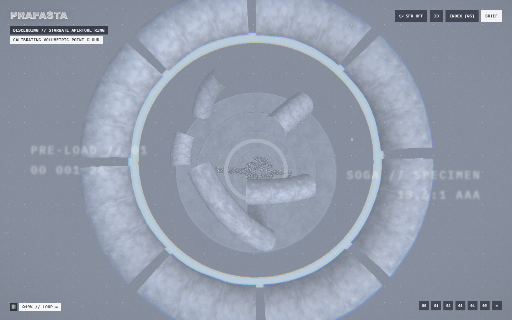
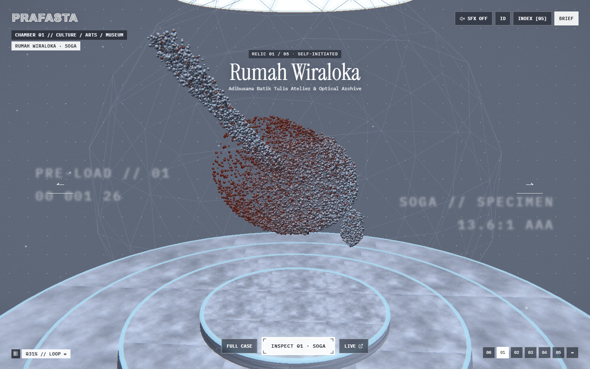
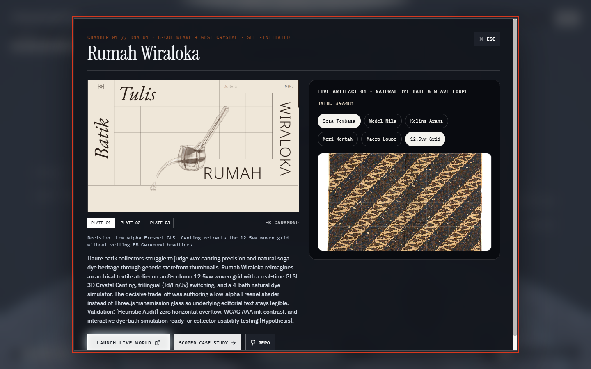

# PRAFASTA · Monograph (Five-World Awwwards Portfolio Hub)

**Live Demo:** [https://prafasta-monograph.vercel.app](https://prafasta-monograph.vercel.app) · **Repository:** [github.com/MrEuwn/portfolio-hub](https://github.com/MrEuwn/portfolio-hub)

| Architectural Gallery Hero | Curatorial Index & CV-Reticle |
| :---: | :---: |
|  |  |

| Darkroom Craft DNA Mixer | Scoped Case Study World |
| :---: | :---: |
|  |  |

Curatorial multi-style UI/UX and Design Engineering portfolio hub synthesizing five live Awwwards-grade showcases into a cohesive two-layer architecture: an **Archival Gallery Host Shell** paired with **5 Isolated Scoped Token Worlds (`data-project-theme`)** and **5 live working interactive micro-artifacts**.

## Featured Five Worlds (All Live)

| Index | World | Category | Style Archetype | Live Demo |
|---|---|---|---|---|
| `01` | **Rumah Wiraloka** | Culture / Arts / Museum | Warm Organic / Craft Atelier | [wiraloka-batik.vercel.app](https://wiraloka-batik.vercel.app) |
| `02` | **KOMA O-III** | Gaming / Audio / Hardware | Monolithic Dark / Cinematic Product | [koma-optics.vercel.app](https://koma-optics.vercel.app) |
| `03` | **SILIKA** | AI Workflow Tool | Tactile Industrial / Hardware Instrument | [silika-vault.vercel.app](https://silika-vault.vercel.app) |
| `04` | **REDAM** | Architecture / Real Estate | Playful Spatial / Tactile Consumer | [redam-acoustics.vercel.app](https://redam-acoustics.vercel.app) |
| `05` | **SOROT** | Agency / Event Microsite | Chromatic Drenched / Bold Brand System | [sorot-scenics.vercel.app](https://sorot-scenics.vercel.app) |

## Architecture Highlights

- **Five-DNA Synthesis Inside One Gallery Shell:** Combines an 8-column `12.5vw` woven architectural grid and GLSL optical refraction monolith (`Wiraloka`), single-context darkroom polarity (`KOMA`), 2D CV-reticle specimen framing (`SILIKA`), morphing floating island navigation (`REDAM`), and `100vw` curved arch wipes plus a bottom-left live world switcher (`SOROT`).
- **Interactive Craft DNA Mixer:** Visitors can test real working simulators from all 5 worlds directly in the browser (Batik Dye Loupe, Optical Filter Bench, Silicon Thermal Comparator, Sabine RT60 Acoustic Calculator, and Live Stage Cue Console).
- **View Transitions API + Isolated Scoped Case Worlds:** Opening any case study switches `data-project-theme="<slug>"` cleanly into that project's authentic palette, typography, annotated multi-plate gallery, Forensic Style DNA Firewall, structured trade-off cards, and honest validation plan.
- **Bilingual `EN / ID` & Accessibility:** Instant language switching, WCAG AA/AAA verified palettes, keyboard focus routing, and full `prefers-reduced-motion` support.

## Local Development

```bash
npm install
npm run dev
```

Runs on `http://localhost:5187`.

## Production Build

```bash
npm run build
npm run preview
```
